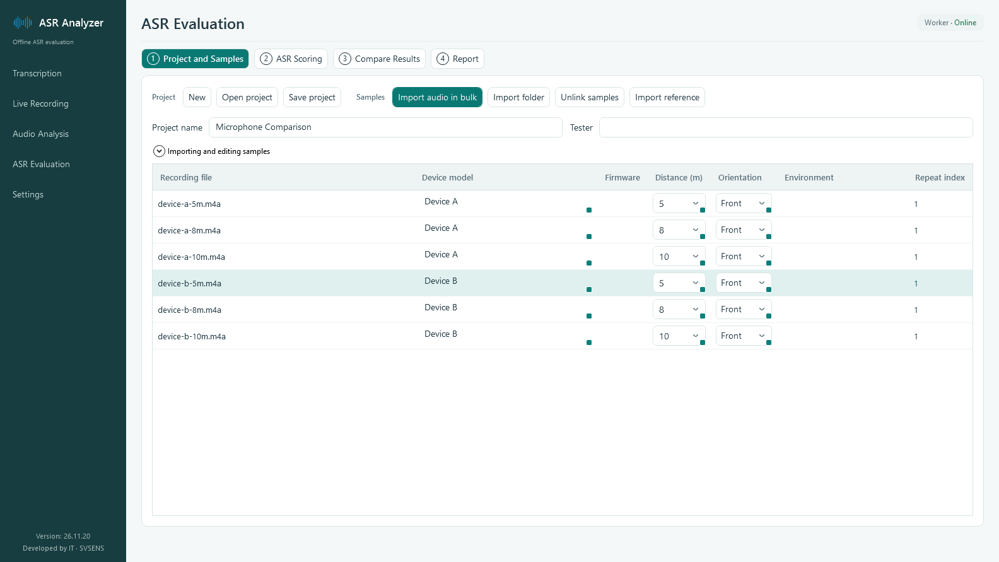
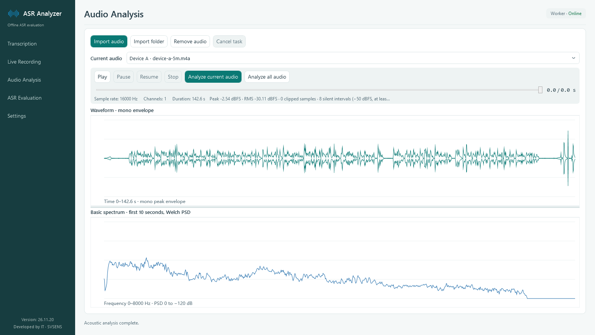
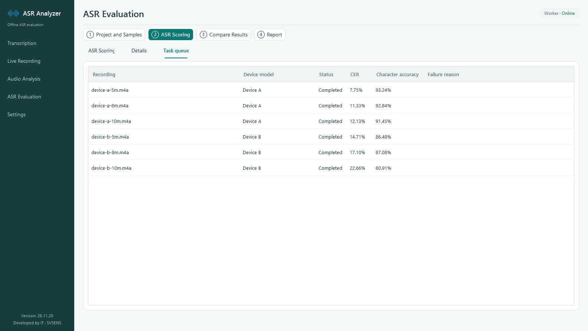
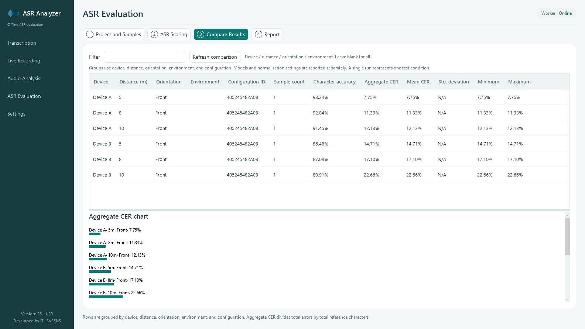

# ASR Analyzer

ASR Analyzer is a Windows x64 desktop tool for offline speech recognition evaluation. Run local transcription, inspect waveforms and spectra, compare microphone recordings across test conditions, and export results to Excel, PDF, or Word. The interface follows the system language by default, with English and Simplified Chinese available in Settings.

## Install ASR Analyzer

1. Download the Windows client and the model ZIPs from [Releases](https://github.com/qishouvip/ASRAnalyzer-Releases/releases). Verify the files against `SHA256SUMS.txt` and extract them into the same writable folder. Windows automatically merges the model directories.
2. Install 64-bit CPython 3.12 and the Microsoft Visual C++ x64 Redistributable if needed. From the extracted folder, run:

   ```powershell
   py -3.12 -m venv runtime/python
   .\runtime\python\Scripts\python.exe -m pip install --extra-index-url https://download.pytorch.org/whl/cpu -r requirements-lock.txt
   ```

3. Obtain FFmpeg from its upstream providers. Put `ffmpeg.exe` at `runtime/ffmpeg/ffmpeg.exe` or select it in Settings.
4. Open `client/ASRAnalyzer.App.exe`. The runtime is fetched from upstream once. Evaluation and inference run locally after setup.

[Python downloads](https://www.python.org/downloads/windows/) · [Microsoft VC++ Redistributable](https://learn.microsoft.com/en-us/cpp/windows/latest-supported-vc-redist) · [FFmpeg downloads](https://ffmpeg.org/download.html)

## Run an evaluation

Create a project under **ASR Evaluation**, import your own recording, add the reference text, and run recognition and scoring. To score English text, import an external transcript. With the default whitespace tokenizer, a reference of `one two` and transcript of `one three` gives a word error rate of 50%.

Use the comparison page to group results by device, distance, orientation, and configuration. Character accuracy measures correct reference characters. CER also counts insertions and can exceed 100%.

## Live recording limitations

The bundled models were validated with Mandarin recordings. In a three-minute real-file replay, the application preserved the captured PCM and finalized all 29 sentences. During a concurrent high-load run, recording stopped early when recognition fell behind. A 10 m sample produced final transcripts without live draft updates. Physical microphone capture has not been field-validated.

## Check for updates

Open **Settings → About and Updates → Check for updates**. A manual check contacts GitHub Releases and displays the date and notes for a newer eligible version. The download button opens the Release page.

## Feedback

Include your ASR Analyzer version, Windows version, model selection, and steps to reproduce. Remove private recordings, transcripts, and local paths before posting.

## 中文简介

ASR Analyzer 是面向 Windows x64 的离线语音识别评测工具，支持本地转写、声学分析、设备与条件对比，以及导出 Excel、PDF 和 Word 报告。客户端默认跟随系统显示语言，也可以在设置中选择简体中文或 English。请使用自己的录音和参考文本评测。
## Screenshots

Screenshots use real evaluation results with anonymized recording and device names. The measurements apply to the test conditions shown.

### Project and Samples

Organize recordings by device, distance, and orientation.



### Audio Analysis

Inspect the waveform, Welch spectrum, peak level, RMS level, and clipping.



### Offline Recognition and Scoring

Run local transcription and track character error rate (CER) and character accuracy by recording.



### Device Comparison

Compare aggregate CER across devices and recording conditions.




